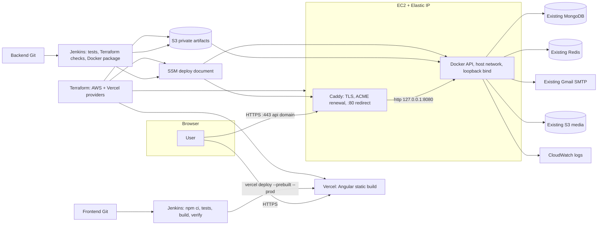

# Stable hosting option: Vercel frontend + direct HTTPS on EC2

> **Current default is the TEMPORARY no-domain demo** (`backend_exposure_mode = "quick_tunnel"`): see [temporary-quick-tunnel-demo.md](temporary-quick-tunnel-demo.md). This document describes `backend_exposure_mode = "direct_https"`, which needs an owned `backend_domain`. Since the Quick Tunnel change, `PUBLIC_API_URL` is no longer a Terraform-managed Vercel variable in either mode: the backend deployment publishes the verified URL (SSM parameter `/lumina/<env>/public-api-url`) and the frontend build compiles it in.

This replaces only the public hosting layer. Password recovery, both Jenkins pipelines, Terraform, EC2, SSM deployment, CloudWatch, the private artifact bucket, the media bucket, MongoDB, Redis and SMTP are unchanged in role.

| | Before | Now |
|---|---|---|
| Frontend | Public S3 website, HTTP only | **Vercel**, HTTPS (Vercel-managed certificate) |
| Backend | Container published on EC2 `:80`, HTTP, ephemeral public IP | **Caddy on the EC2 instance**: `:443` TLS (Let's Encrypt via ACME), `:80` redirect/ACME only, **Elastic IP** |
| API process | `0.0.0.0:80 → container :8080` | `127.0.0.1:8080` only (host network), never public |
| Frontend deploy | Jenkins → `aws s3 sync` | Jenkins → `vercel deploy --prebuilt --prod` (sole production deployer) |
| Backend deploy | Jenkins → S3 artifact → SSM | unchanged path; SSM document also converges Caddy and verifies HTTPS |

No ALB, CloudFront, new database or new Redis. S3 remains for **media** (existing bucket, not managed here), **private release artifacts**, and **remote Terraform state** (separate bootstrap bucket).

## Decisions

**Reverse proxy: Caddy.** The audit found no proxy on the instance (bootstrap installs only Docker, AWS CLI and Python; the container itself listened on host `:80`). Caddy gives ACME issuance, automatic renewal, HTTP→HTTPS redirect and reverse proxying in one service with no extra timer or plugin. Amazon Linux 2023 has no Caddy package, so the SSM document installs the **official release binary pinned by version and SHA-512** (`caddy_version`, `caddy_sha512`) and the upstream systemd unit (`infra/terraform/caddy.service`, user `caddy`, only `CAP_NET_BIND_SERVICE`). Nginx/Certbot is not installed.

**Proxy bootstrap through SSM, not user data.** `aws_instance.backend` has `user_data_replace_on_change = true`; editing `bootstrap.sh` would replace the instance. Instead the Terraform-managed SSM deployment document runs `proxy.sh.tftpl` on every deployment: it is idempotent (download only on version change, validate config as the `caddy` user, restart on binary/unit change, graceful reload on config change, no-op otherwise) and overwrites manual drift. Existing and newly created instances converge the same way.

**Loopback bind + host network.** With bridge networking and `-p 127.0.0.1:8080:8080`, Express would see the Docker gateway as the peer and every client would share one rate-limit bucket. The container therefore runs with `--network host -e HOST=127.0.0.1`; Caddy dials `127.0.0.1:8080`. The Caddy admin API is moved to a Unix socket (`/run/caddy/admin.sock`, owner-only) so the host-network container cannot reconfigure the proxy over `localhost:2019`.

**Trust proxy.** `TRUST_PROXY=loopback` (set only by the deploy document) makes Express trust exactly `127.0.0.0/8` and `::1`. Any other value, including `true`, leaves trust disabled. Caddy discards client-supplied `X-Forwarded-For` and sets the real peer, plus `X-Forwarded-Proto: https` and the original `Host`. Recovery IP limits (30/IP/hour) therefore key on the real client. `X-Real-IP` is not added: nothing reads it, and an extra trusted header is only attack surface.

**CORS.** `config/cors.js` allows exact origins from `CORS_ORIGINS`, which Terraform derives (`https://<vercel production domain>` and, if set, `https://<frontend_domain>`) and injects through the SSM document. Production refuses to start without it and rejects `*`, wildcards, `http://` and paths. Requests without `Origin` (health checks) are unaffected. Outside production, `http://localhost:*` and `http://127.0.0.1:*` remain allowed for development.

**Frontend deployment owner: Jenkins.** The Vercel project has no Git repository connected, so pushes never trigger Vercel builds. Jenkins packages the already-tested `dist/luminabeauty-app/browser` as Vercel Build Output API v3 (`ci/stage-vercel-output.mjs`) and uploads it with `vercel deploy --prebuilt --prod`; Vercel never rebuilds it. Routing: hashed assets `immutable`, `release.json` `no-store`, real files first, then extension-less paths (Angular routes) rewrite to `index.html`; a missing `.js`/`.css` returns 404 instead of HTML.

## Terraform

One stack, `infra/terraform`, now with two providers: `hashicorp/aws ~> 6.0` (locked 6.70.0) and `vercel/vercel ~> 5.21.1` (locked 5.21.1). The Vercel token is read only from `VERCEL_API_TOKEN`; never put it in tfvars.

New/changed inputs: `backend_exposure_mode = "direct_https"`, `backend_domain` (required in this mode, hostname only), `public_ingress_cidrs` (default `0.0.0.0/0`; replaces `backend_ingress_cidrs`), `caddy_version`/`caddy_sha512`, `vercel_team`, `vercel_project_name` (default `lumina-<env>-frontend`), `vercel_production_domain` (only if Vercel assigned something other than `<project>.vercel.app`), `frontend_domain` (optional custom domain), `legacy_frontend_website` (default `true`).

Managed: `vercel_project` (framework `angular`, `npm ci`, production build command, output directory, Node 22, Standard Protection: previews and generated deployment URLs require login, production domains are public), optional `vercel_project_domain`, `aws_eip` (with `prevent_destroy`) + `aws_eip_association`, security-group rules 443 and 80. Deployments themselves are not Terraform resources.

Outputs: `backend_elastic_ip`, `backend_domain`, `backend_https_url`, `backend_api_url`, `backend_dns_record`, `vercel_project_id`, `vercel_team_id`, `vercel_production_url`, `frontend_url`, `frontend_origins`, `legacy_frontend_bucket`, `legacy_frontend_website_url`. No secrets.

### Plan expectations (first apply)

Simulated against an emulator state built from the previous configuration (see the verification report for evidence): **5 add, real in-place changes to the deploy document and Jenkins IAM policies, 1 destroy, 0 replace** (re-measured with `backend_exposure_mode = "direct_https"` after the Quick Tunnel change; 3 further in-place updates were emulator read-back noise).

- add: `aws_eip.backend`, `aws_eip_association.backend`, ingress `http["0.0.0.0/0"]` and `https["0.0.0.0/0"]`, `vercel_project.frontend` (+1 `vercel_project_domain` if `frontend_domain` is set)
- change: `aws_ssm_document.deploy` (new script), `aws_iam_policy.jenkins_plan` (EIP describe permissions)
- destroy: the old port-80 ingress rule(s) keyed by the former `backend_ingress_cidrs` (the application is no longer behind that rule)
- moved only (no change): `aws_s3_bucket_website_configuration.frontend`, `aws_s3_bucket_policy.frontend`, `aws_iam_policy.jenkins_frontend` → `[0]`

Any planned replacement or destruction of the EC2 instance, IAM role/profile, SSM document, CloudWatch log group, artifact bucket or EIP is a stop condition. Do not apply such a plan.

### DNS

DNS stays with its current provider; no Route 53 zone exists in this project. After apply, create exactly the record printed by `terraform output backend_dns_record`, e.g. `api.example.com. A <backend_elastic_ip>`. For a custom frontend domain, add the record Vercel shows for that domain in the project's Domains page. The first HTTPS deployment cannot obtain a certificate until the API record resolves to the Elastic IP; the deploy fails visibly until it does.

## Rollout runbook

1. Export `VERCEL_API_TOKEN` (operator shell) and real AWS credentials. Add `backend_domain` (and optional Vercel inputs) to the real tfvars; remove `backend_ingress_cidrs`.
2. `terraform init -reconfigure -backend-config=backend.hcl`, then `terraform plan -var-file=terraform.tfvars -out=reviewed.tfplan`. Compare with the expectations above. Apply only after review.
3. Create the DNS A record from `backend_dns_record`. Confirm it resolves.
4. Backend Jenkins `main` + `DEPLOY=true`: SSM deploys the container on loopback, converges Caddy, waits for the trusted certificate, and Jenkins verifies public HTTPS health/revision, the HTTP→HTTPS redirect and that the app port is unreachable.
5. Frontend Jenkins `main` + `DEPLOY=true` with `PUBLIC_API_URL` = `backend_api_url`, `FRONTEND_URL` = `frontend_url`, `VERCEL_ORG_ID` = `vercel_team_id` (for a personal account, the account ID from Vercel settings), `VERCEL_PROJECT_ID` = `vercel_project_id`.
6. Browser-check the production URL: login, recovery, customer/admin routes, deep links, no mixed content.
7. **Decommission the old website** only after step 6: set `legacy_frontend_website = false`, plan (expect destroy of `aws_s3_bucket_website_configuration.frontend[0]`, `aws_s3_bucket_policy.frontend[0]`, `aws_iam_policy.jenkins_frontend[0]`, and an in-place public-access-block update to fully private), apply. The bucket, its versions and encryption remain as a private archive.
8. Optional final removal of the private legacy bucket is manual: empty all object versions, delete the bucket, then drop `aws_s3_bucket.frontend` and its `buckets["frontend"]` controls from configuration with `removed` blocks. Never touch the media, artifact or state buckets.

The old S3 website is not a working fallback once step 4 runs: its bundle targets the retired `http://<old public IP>/api` endpoint and its origin is not in `CORS_ORIGINS`. It is retained only so nothing is destroyed before Vercel is verified. Roll forward on Vercel (redeploy a previous frontend revision through Jenkins).

## Jenkins credentials

| ID | Job | Use |
|---|---|---|
| `lumina-aws-deploy` | backend | unchanged: artifact upload, SSM, plan read, state access |
| `lumina-vercel-terraform` | backend | secret text → `VERCEL_API_TOKEN` so the drift-blocking plan can refresh Vercel resources |
| `lumina-terraform-backend`, `lumina-terraform-vars` | backend | unchanged secret files (vars now include `backend_domain`) |
| `lumina-vercel-token` | frontend | secret text → `VERCEL_TOKEN` for the pinned Vercel CLI (`VERCEL_CLI_VERSION=62.7.0`) |

`lumina-aws-frontend` is no longer used by the frontend pipeline. Its policy disappears in step 7.

## Certificates and renewal

Certificates, ACME account keys and private keys exist only in `/var/lib/caddy` on the instance's encrypted EBS volume, never in Git, Terraform variables or state. Caddy renews automatically in-process (roughly 30 days before expiry for Let's Encrypt). Check on the instance through SSM Session Manager: `systemctl is-active caddy`, `journalctl -u caddy | grep -i 'certificate obtained'`. HTTP/3 is disabled because the security group exposes TCP only.

## Limits

The application port is closed by the security group and by the loopback bind. SSH is not opened; administration remains SSM. Caddy access logs go to journald, not CloudWatch. Deployment has brief downtime while the container restarts (Caddy returns 502 meanwhile). Vercel production-domain visibility under Standard Protection and the actual generated `*.vercel.app` hostname must be confirmed on the first live deployment; set `vercel_production_domain` if Vercel added a suffix.
