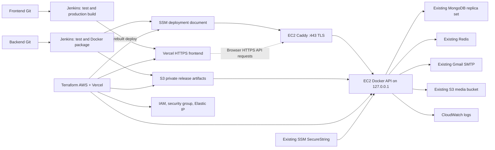

# LuminaBeauty — password recovery, Jenkins and AWS

## Authentication and recovery

Read [the preimplementation audit](auth-deployment-audit.md) for the original design. The current source uses email, Express/Mongoose, bcryptjs cost 10, Redis and Nodemailer. Its `2fa` screen follows **registration**, while normal login immediately issues a four-hour JWT. The implementation preserves this architecture and existing purposes `2fa` / `reset`; it does not claim that login now has per-session MFA.

`/auth/login` links to the lazy `/auth/restore` page. Its in-memory states are identifier → code → new password. It uses the current auth layout/card, reactive forms, signals, shared alerts, FormUtils password matching and shared `apiErrorMessage` parser. Resend waits 30 seconds; back navigation clears authorization/passwords. A successful reset returns to `/auth/login?reset=success`. Tokens/passwords are never placed in URLs or browser storage. Reloading requires starting recovery again.

All endpoints below are public by necessity, validate their inputs and return `{ok,msg}` or the existing express-validator validation messages in `{ok:false,msg}` format. Code verification and reset responses have `Cache-Control: no-store`.

| POST under `/api/auth` | Body | Result |
|---|---|---|
| `/password/request` | `email` | Generic message, `retryAfter: 30`; no code or account details |
| `/password/verify` | `email`, eight-digit `code` | Opaque `resetToken`, `expiresIn: 300` |
| `/password/reset` | `resetToken`, `newPassword`, `confirmPassword` | Password changed; return to login |
| `/request-code` | `email`, `type: reset` | Compatibility alias for the protected request operation |
| `/password/verify-reset` | Any | HTTP 410; the combined legacy reset cannot bypass authorization |

Request trims/lowercases email and performs an escaped literal case-insensitive lookup, supporting existing mixed-case email records. Disabled and Google-only accounts receive the same generic response and no reset mail. Missing accounts receive the same response and rate limits. Email failures do not disclose account existence. A 500 ms floor reduces the obvious fast missing-account path; synchronous external SMTP latency can still differ. This is not a claim of constant-time enumeration protection. The existing registration/login endpoints already disclose account existence; they are outside this recovery redesign.

The shared `helpers/email-generator.js` generates eight digits using Node crypto and the existing branded email template, with purpose, 15-minute expiry and unsolicited-request notice. Nodemailer keeps Gmail transport and MAIL_USER/MAIL_PASS. Failed delivery now throws and removes the undelivered code rather than silently succeeding; the recovery controller deliberately preserves its generic acknowledgement. No OTP is logged or returned.

`helpers/db-redis-codes.js` retains `${type}:${normalizedEmail}`, now storing a SHA-256 digest rather than the plaintext code, with **900 seconds TTL**. Lua atomically compares, counts failures and consumes the code. There are **5 attempts** per 15-minute window; resending does not reset this budget. Requests enforce **30 seconds cooldown**, **5 sends/account/hour**, and **30 requests/IP/hour**, including missing accounts and the legacy reset alias. Related keys append `:attempts`, `:cooldown`, `:requests`; IPs are hashed. Direct EC2 access uses the actual peer IP; configure a precise Express trust-proxy policy before adding a proxy. Do not blindly trust forwarded headers.

Verification always consumes `reset`, never `2fa`. It issues 32 random bytes encoded as 64 hex characters; Redis stores only the token's SHA-256 key at `reset:authorization:<digest>`, for **300 seconds**, associated with user ID and the existing password hash. Reset validates the registration policy (**minimum 4 characters, no additional complexity**) and matching confirmation before `GETDEL`. Mongo's conditional update matches that user ID and previous hash, preventing cross-account selection and multiple concurrent authorizations from changing the password twice. bcryptjs hashes the new password with cost 10. Outstanding authorizations based on the old password become unusable, and the current recovery code is deleted.

Security tradeoffs: there is no refresh-token/session revocation store in this project. Existing JWTs may remain usable until their four-hour expiry; this is documented, not falsely described as revoked. A consumed authorization is not restored after a database outage: request a new code. Codes generated before this release's digest migration will fail verification; resend after the 30-second limit. This design targets the existing standalone Redis configuration, not Redis Cluster Lua cross-slot execution.

## Tests and browser QA

Use Node 22.12+, MongoDB (`mongod`) and Redis (`redis-server`) on PATH:

```bash
npm ci
npm test
```

The recovery integration test uses real isolated MongoDB/Redis processes, actual HTTP routes and a local SMTP capture server. It tests delivery/TTL, generic responses, normalization, cooldown/hourly limits, invalid/expired/wrong-purpose codes, replay, authorization expiry, confirmation/policy, forged identity, concurrent consumption, old/new passwords and `/api/health` revision/readiness.

The browser runner exercises the **compiled production frontend** with Chrome and these real backend dependencies; no authentication API mock is used. `NODE_ENV=test` plus `QA_SMTP_PORT` enables loopback-only QA SMTP. The fixture creates only temporary accounts/databases, keeps email capture in process memory and exposes no code-retrieval endpoint. This path cannot be enabled by QA_SMTP_PORT alone in production.

```bash
# In the frontend repository:
npm ci
npm run build -- --configuration production
# In the backend repository, with Node 22:
FRONTEND_DIR=../seminario-sistemas-1-proyecto-unico-frontend-2026 node qa/recovery-browser.js
```

The local server proxies `/api` to the isolated backend and serves the Angular build with SPA fallback. The script verifies wrong/correct codes, real SMTP receipt, password reset, old-password failure, new-password success and replay. It runs Chrome axe including contrast on all three steps and checks 390/1280-pixel layouts. Sanitized results and screenshot are written to `/tmp/lumina-recovery-browser-results.json` and `/tmp/lumina-recovery-browser.png`; tokens/passwords are not written there.

## Jenkins

Both repositories now have a root `Jenkinsfile`. A Linux agent labeled `lumina-ci` needs Node 22.12+, npm, AWS CLI v2, Python 3 and Bash. The backend also requires Docker, MongoDB, Redis and Terraform >=1.10,<2. Docker runs the production Node 22 Alpine image as `node`; Compose explicitly selects the development target and retains nodemon/bind mounts. No compiled backend exists: build checks JavaScript syntax, builds the image, verifies its entrypoint/user, and saves a gzip Docker archive plus SHA-256 checksum.

Backend stages: checkout → runtime → `npm ci` → `npm test` → Terraform format/init/validate/mock security test → production image/package checks → on protected main with DEPLOY=true, remote-state plan → S3 artifact upload → SSM command (container on loopback + Caddy convergence) → internal health, Caddy active, public HTTPS health/revision with normal certificate validation, HTTP→HTTPS redirect and closed application port. The remote-state plan uses `-detailed-exitcode`; **both error (1) and pending infrastructure changes (2) stop deployment**. Apply infrastructure separately before deploying an application. No Jenkins stage applies or destroys infrastructure.

Frontend stages: checkout → runtime → `npm ci` → `npm test -- --watch=false` → production build → verify/package `dist/luminabeauty-app/browser` → on protected main with DEPLOY=true, prebuilt Vercel production deployment of that exact artifact → verify production URL (release marker, every JS/CSS hash, deep links, immutable caching, 404 for missing assets). Hosting details: [https-vercel-migration.md](https-vercel-migration.md).

Feature branches, PRs and develop run tests/build only. Use a **trusted protected-main deployment job/credential scope**, isolated from untrusted PR jobs. A modified Jenkinsfile on an untrusted branch is not a security boundary by itself. Protect main and restrict who can run DEPLOY=true. `disableConcurrentBuilds` serializes each job; EC2 also uses `flock`. Do not configure multiple frontend deployment jobs for the same bucket.

Required Jenkins plugins: Pipeline/Declarative, Git/Multibranch, Credentials Binding and AWS Credentials. Credential IDs:

| ID | Type / usage |
|---|---|
| `lumina-aws-deploy` | AWS credentials binding; preferably short-lived assumed-role credentials; backend artifact/SSM + plan read + state access |
| `lumina-vercel-terraform` | Secret text → `VERCEL_API_TOKEN` for the backend job's Terraform plan (Vercel provider) |
| `lumina-vercel-token` | Secret text → `VERCEL_TOKEN`, frontend Vercel deployment only |
| `lumina-aws-frontend` | Legacy S3 website publisher; unused since the Vercel migration |
| `lumina-terraform-backend` | Secret file with remote-state backend HCL; no application secrets |
| `lumina-terraform-vars` | Secret file with real non-secret infrastructure inputs, matching already-applied stack |

The AWS binding supplies AWS_ACCESS_KEY_ID/AWS_SECRET_ACCESS_KEY and session token where applicable at runtime. No values are committed or echoed. The EC2 role uses the SDK default credential chain; it never needs static keys. Terraform outputs provide separate backend-deploy, frontend-deploy and infrastructure-plan policy ARNs. Attach them to existing Jenkins deployment identities. The backend identity additionally needs access to the private **state bucket/key and lockfile**, supplied by the state bootstrap owner; this stack does not grant arbitrary S3 state access. Provider API requirements can change; review any live-plan AccessDenied rather than granting AdministratorAccess.

Parameters: backend `AWS_REGION` must match Terraform inputs; frontend `PUBLIC_API_URL` (`backend_api_url` output, HTTPS), `FRONTEND_URL` (`frontend_url`), `VERCEL_ORG_ID` (`vercel_team_id`) and `VERCEL_PROJECT_ID` (`vercel_project_id`). The deploy refuses a build whose API URL differs from the Terraform-managed Vercel `PUBLIC_API_URL`.

`npm run build` generates an ignored public `environment.production.ts`, preserving the current payment-account settings and replacing only baseUrl. Production replacements cover both existing environment imports. The local default is `/api`; Vercel deployment requires the explicit `https://<backend_domain>/api` URL. No backend secrets belong in frontend configuration. Direct `ng build` needs `node ci/configure-build.mjs` first; `npm run build` runs it automatically.

Groovy parsing checks syntax only, not Jenkins plugin availability/Declarative semantics. With a real Jenkins controller, run its [Declarative linter](https://www.jenkins.io/doc/book/pipeline/development/) and both actual jobs before marking Jenkins execution PASS. The current environment has no configured controller.

## AWS infrastructure and deployment

Terraform is in `infra/terraform`; no previous IaC existed. It references an existing VPC/public subnet, media bucket, MongoDB and Redis. The existing MongoDB deployment must support the application's order transactions (replica set). This task provisions no new database or Redis and does not run destructive migrations. Existing schema migration procedures remain separate from application deployment.

Resources: encrypted EC2 root disk, IMDSv2, instance role/profile, security group with ingress **only 443 and 80** (Caddy TLS and redirect/ACME), Elastic IP, SSM management, CloudWatch log group with 30-day retention, constrained SSM deployment document, the deprecated S3 website bucket (retained until decommissioned) and private TLS-only artifact bucket. Both buckets have encryption, ownership enforcement and versioning. Inbound is limited to `public_ingress_cidrs` on 443/80; no SSH, application, MongoDB or Redis ports are open. The Vercel project is managed by the same stack. Outbound: HTTPS for AWS/Google/packages, Gmail SMTPS 465, and explicitly supplied database/Redis CIDRs/ports. Choose private/restricted service destinations and configure their own allowlists for this EC2 host.

The EC2 role reads only the named environment parameter and release objects, writes application logs, accesses the configured media prefixes, and uses AmazonSSMManagedInstanceCore. A customer KMS key is optional and its decrypt grant is limited to SSM use. It does not receive AdministratorAccess. The SSM document permits only a release key matching a 40-hex Git revision, a 64-hex checksum and a 40-hex version; the bucket/environment parameter are fixed by IaC. Jenkins cannot use this policy to run arbitrary AWS-RunShellScript commands.

EC2 bootstrap installs/enables Docker and SSM and creates `/opt/lumina` mode 0700. Deployment fetches and checks the image archive, retrieves the SecureString to a root-only env file, validates configuration, loads the image, verifies its embedded revision label, stops the previous container and starts the new one on the host network bound to `127.0.0.1` (TRUST_PROXY=loopback, exact CORS_ORIGINS) with restart policy, read-only root filesystem, temporary `/tmp`, dropped capabilities and CloudWatch logging. There is brief downtime. It checks process status and `/api/health` (MongoDB + Redis readiness and APP_VERSION) on loopback, then installs/updates Caddy (pinned, SHA-512 verified), validates and applies its configuration and checks the full HTTPS path through Caddy with a trusted certificate. Failure returns nonzero and fails Jenkins. It does not claim automatic rollback; redeploy a reviewed prior artifact/revision to roll back.

Required SSM SecureString dotenv entries (one unquoted KEY=value per line; never commit values): MONGODB_CNN, REDIS_URL, SECRETEORPRIVATEKEY, MAIL_USER, MAIL_PASS, AWS_BUCKET_NAME. Existing optional GOOGLE_CLIENT_ID may also be supplied if configured by the project. Deployment sets NODE_ENV=production, HOST, PORT, TRUST_PROXY, CORS_ORIGINS, AWS_REGION and APP_VERSION itself and rejects QA_SMTP_PORT/static AWS keys. Mail sender remains the existing LuminaBeauty sender; configure Gmail credentials and sender authorization externally.

### State and commands

Create a separate private encrypted/versioned remote-state bucket using the team's bootstrap process. Enable S3 state locking (`use_lockfile=true`) and give the operator/Jenkins role only its environment key and `.tflock`. Do not reuse either application bucket for state. Terraform does not create or read the application SecureString contents, avoiding secrets in plan/state from this implementation. State files, actual tfvars, backend.hcl and plans are ignored; `.terraform.lock.hcl` is intended for review/commit.

```bash
cd infra/terraform
terraform fmt -check -recursive
terraform init -backend=false -input=false
terraform validate
terraform test                       # mocked plan only; no AWS resources
# Configure real backend.hcl and terraform.tfvars from the examples first:
terraform init -reconfigure -backend-config=backend.hcl
terraform plan -var-file=terraform.tfvars -out=reviewed.tfplan
# Only after explicit operator authorization and review:
terraform apply reviewed.tfplan
terraform output
```

No apply/destroy was executed during this task. Local validate/mock tests are not proof of a valid live plan. The available AWS credentials were rejected by STS with InvalidClientTokenId; real VPC/subnet/service configuration and valid credentials are still required.

The subnet must route to an internet gateway and allow return traffic. **Current default: TEMPORARY no-domain demo** with a Cloudflare Quick Tunnel (no inbound rules, random `*.trycloudflare.com` URL that changes on restart): [temporary-quick-tunnel-demo.md](temporary-quick-tunnel-demo.md). **Superseded:** the HTTP-only S3 website and the direct HTTP EC2 endpoint described in earlier revisions are replaced by Vercel HTTPS and Caddy HTTPS on an Elastic IP; no ALB or CloudFront. DNS records, certificate handling, decommissioning and the expected plan are in [https-vercel-migration.md](https-vercel-migration.md).



## Verification limits and inherited issues

See the final verification report for fresh counts. Local tests, browser QA, build and Terraform validation do not prove Jenkins/AWS execution. npm ci reported existing dependency advisories: backend 6 (4 moderate, 2 high); frontend 16 (5 moderate, 9 high, 2 critical). No forced dependency upgrades were performed. The production frontend also has an initial bundle warning and an existing unused CurrencyPipe warning. These are review items alongside legacy MFA/JWT limitations.

Both working trees had substantial uncommitted order/report work before this task. It is preserved. No commit, push or production environment/state file was created or published.
