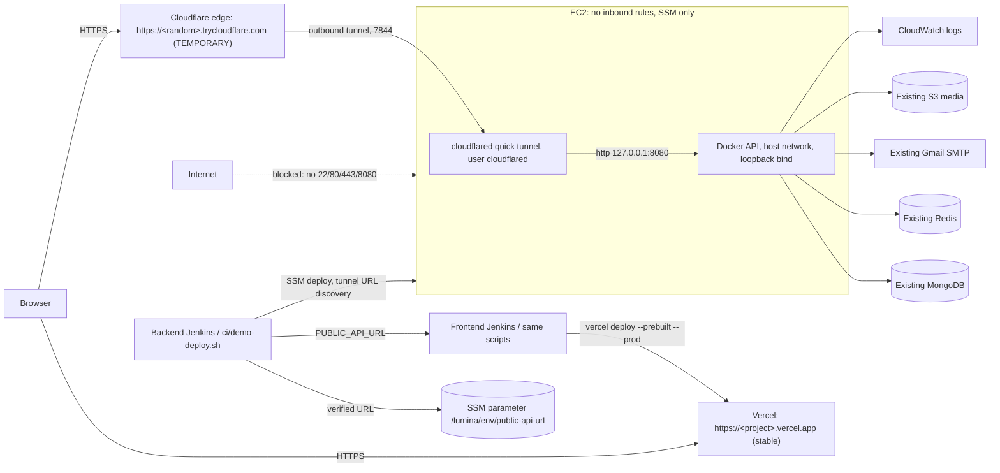

# TEMPORARY no-domain demo: Vercel frontend + Cloudflare Quick Tunnel backend

> **Temporary deployment / demo: supported. Stable production: NOT supported.** A Cloudflare Quick Tunnel gets a random `https://<words>.trycloudflare.com` hostname that **changes whenever the tunnel process restarts**: `cloudflared` restart or crash, EC2 reboot, service or binary change, or a deliberate rotation. Cloudflare does not guarantee Quick Tunnel uptime. Use it to demo without buying a domain. For stable production, see [Future stable production](#future-stable-production).

This is the Terraform default, `backend_exposure_mode = "quick_tunnel"`. The stable direct-HTTPS implementation (Caddy + Let's Encrypt + Elastic IP) is kept behind `backend_exposure_mode = "direct_https"`; see [https-vercel-migration.md](https-vercel-migration.md).



## What runs where

- **EC2:** the API container listens only on `127.0.0.1:8080` (`--network host -e HOST=127.0.0.1`). The security group has **no inbound rule at all**: no 22, 80, 443 or 8080. Administration and deployment stay on SSM. Egress adds only 7844 TCP/UDP for the tunnel; 443 covers tunnel registration, the binary download and the existing AWS/SMTP/Google traffic.
- **cloudflared:** pinned official release `2026.10.0`, installed by the Terraform-managed SSM deploy document and verified against the SHA-256 from Cloudflare's release notes. It runs as the `lumina-quick-tunnel` systemd unit: dedicated `cloudflared` user, no capabilities, `ProtectSystem=strict`, `Restart=on-failure`, journald logging, `--no-autoupdate`. There is no Cloudflare account, token or config file; the script refuses to run if a named-tunnel `config.yml` exists.
- **URL discovery:** cloudflared's loopback metrics server (`127.0.0.1:20241/quicktunnel`) returns `{"hostname": ...}`. The script polls it with a bounded wait (no fixed sleep). The hostname must match `<label>.trycloudflare.com`; the published URL is `https://<host>/api`, with no credentials, port, query or fragment. Then `/api/health` must return healthy, with the deployed revision, **through the public tunnel** using normal TLS validation (no `-k`). Anything else fails the deployment.
- **Restarts:** the tunnel is restarted only on first install, binary or unit change, if it is not running, or on explicit rotation. A normal backend redeploy keeps the same URL.
- **Client IP:** `TRUST_PROXY=cloudflared`. Express ignores `X-Forwarded-For`. `req.ip` becomes Cloudflare's `CF-Connecting-IP` only when the TCP peer is loopback, which can only be the local cloudflared because the API listens on loopback. A missing or malformed header falls back to `127.0.0.1`, so the limit becomes stricter, never bypassable. The password-recovery limit of 30 requests/IP/hour is therefore keyed by the real client. `qa/tunnel-headers.js` audits Cloudflare's actual headers live.
- **CORS:** exactly `https://<project>.vercel.app` (plus `frontend_domain` only if set). The tunnel URL is the API origin, not a browser origin, so it is never in `CORS_ORIGINS`. No `*` or `*.vercel.app`.
- **Frontend API URL:** a single source of truth, the backend deployment. `ci/deploy.py` takes the URL the instance reports and re-verifies it from outside. It then writes it to the non-secret SSM parameter `/lumina/<env>/public-api-url` and to `artifacts/public-api-url.txt` and `artifacts/frontend.env`, which carry it to the frontend build. Terraform no longer sets a Vercel `PUBLIC_API_URL` variable, so nothing fights the live value.
- **Frontend deploy:** before uploading, `ci/check-api.mjs` refuses an API URL that is not healthy or whose CORS does not allow the frontend origin; this catches a stale tunnel URL. After deploying, `ci/verify-deployment.mjs` requires the live bundle to embed **exactly** that URL.

## URL rotation (accepted temporary limitation)

```txt
1. backend deployed, tunnel URL-A        4. cloudflared restarts (or EC2 reboots)  -> URL-B
2. backend job publishes URL-A           5. tunnel-status (or tunnel-rotate) detects URL-B
3. frontend deployed with URL-A          6. URL-B verified and published
                                         7. frontend rebuilt/redeployed with URL-B
                                         8. Vercel now calls URL-B
```

Between steps 4 and 7 the live frontend still calls URL-A, which no longer exists, so **the API is unavailable to users until the frontend is redeployed**. A redeploy with the stale URL is refused by `ci/check-api.mjs`. Nothing redeploys automatically after an unattended restart: after any EC2 reboot or tunnel crash, run the backend action `tunnel-status` (Jenkins parameter or `ci/demo-deploy.sh tunnel-status`). Compare with `aws ssm get-parameter --name /lumina/<env>/public-api-url`.

## Manual first deployment (no Jenkins)

Prerequisites on the operator machine: Node 22.12+, npm, Docker, MongoDB and Redis binaries (for the test suite), Terraform 1.10–1.x, AWS CLI v2, Python 3, an AWS identity allowed to plan/apply and to use the Jenkins backend policy actions, and a Vercel token. Run everything from the backend repository.

```bash
# 0. Credentials only in the shell, never in files
export AWS_PROFILE=...            # or temporary AWS credentials
export VERCEL_API_TOKEN=...       # Terraform Vercel provider
export VERCEL_TOKEN=...           # Vercel CLI (may be the same token)
# export VERCEL_ORG_ID=...        # only for a personal Vercel account (no team)
export TF_VARS=$PWD/infra/terraform/terraform.tfvars   # copied from terraform.tfvars.example; git-ignored
export FRONTEND_DIR=../seminario-sistemas-1-proyecto-unico-frontend-2026

# 1. Infrastructure (review the plan first; see "Expected plan" below)
terraform -chdir=infra/terraform init -reconfigure -backend-config=backend.hcl
terraform -chdir=infra/terraform plan -var-file="$TF_VARS" -out=reviewed.tfplan
terraform -chdir=infra/terraform apply reviewed.tfplan
# Store the application dotenv in the existing SSM SecureString named by app_env_parameter_name (unchanged).

# 2-7. Backend via SSM, tunnel URL discovery and verification, then frontend build and Vercel deploy with that URL.
#      Same gates and scripts as Jenkins: npm ci, tests, drift-blocking plan, ci/build.sh, ci/deploy.sh,
#      frontend tests/build, ci/verify-artifact.mjs, ci/deploy.sh (check-api, stage, vercel deploy, verify).
bash ci/demo-deploy.sh deploy

# After an EC2 reboot / cloudflared restart: re-detect the URL and redeploy the frontend
bash ci/demo-deploy.sh tunnel-status
# Deliberate rotation (e.g. to test step 4-8 above)
bash ci/demo-deploy.sh tunnel-rotate
```

8. Browser check on `https://<project>.vercel.app` with DevTools → Network: every request is HTTPS, API calls go to the printed `*.trycloudflare.com/api`, and there are no mixed-content warnings. Check login, password recovery (request, wrong code, correct code, new password, old password fails, new password works, replayed code fails), customer flows (`/products`, `/cart`, `/my-orders`), admin flows (`/admin/dashboard`, `/admin/reports/sales`), and a direct load of each deep link.

Optional, before the first deploy: run `CLOUDFLARED_BIN=<pinned cloudflared> node qa/tunnel-headers.js`. It opens a **short-lived public** Quick Tunnel to a local probe route only, records the headers Cloudflare actually delivers, checks that spoofed `CF-Connecting-IP` and `X-Forwarded-For` values do not change `req.ip`, and checks that a restart rotates the hostname.

## Jenkins (when a controller exists)

Order is mandatory: **backend job first, frontend second**. The backend Jenkinsfile runs its `deploy`, `tunnel-status` or `tunnel-rotate` action (`BACKEND_ACTION`, with `DEPLOY=true` on protected `main`). It then triggers `FRONTEND_JOB` with `DEPLOY=true` and the verified `PUBLIC_API_URL`, `FRONTEND_URL`, `VERCEL_ORG_ID` and `VERCEL_PROJECT_ID` (non-secret, from Terraform outputs). The frontend job remains the only Vercel deployer. Running the frontend job alone requires passing the current URL from the SSM parameter. Credentials: backend `lumina-aws-deploy`, `lumina-vercel-terraform`, `lumina-terraform-backend`, `lumina-terraform-vars`; frontend `lumina-vercel-token`.

## Expected plan from the currently applied stack

Simulated against an emulator state built from the previously applied configuration: **4 add, 3 real changes, 1 destroy, 0 replace**.

- add: `aws_ssm_document.tunnel[0]`, egress `tunnel["tcp"]` and `tunnel["udp"]` (7844), `vercel_project.frontend`
- change: `aws_ssm_document.deploy`, `aws_iam_policy.jenkins_backend` (tunnel document, URL parameter, describe-instances), `aws_iam_policy.jenkins_plan`
- destroy: the old public port-80 app rule(s) from `backend_ingress_cidrs`; closing them is the intent
- moved only: legacy S3 website configuration and policy, legacy S3 publisher policy
- Not created in this mode: Elastic IP, 80/443 ingress, Caddy

Stop if a plan replaces or destroys the EC2 instance, IAM role/profile, deploy document, log group or artifact bucket.

## Future stable production

Either a Cloudflare account with a domain on Cloudflare and a **named Cloudflare Tunnel** with a stable public hostname (same outbound-only, no-inbound EC2 model; replace the quick-tunnel unit with a token-based connector stored in SSM), or `backend_exposure_mode = "direct_https"` with an owned `backend_domain` (Caddy, Let's Encrypt, Elastic IP). Both give a fixed API URL, so the frontend no longer needs redeploying when the backend restarts.
